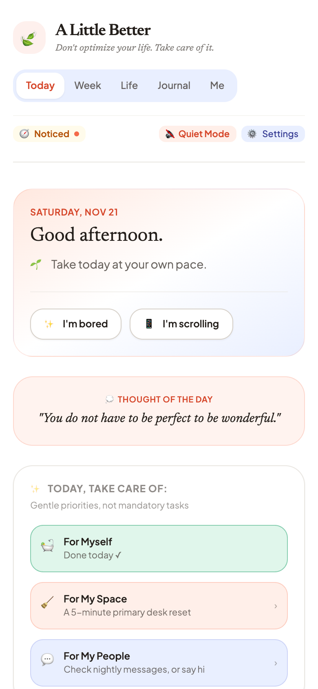
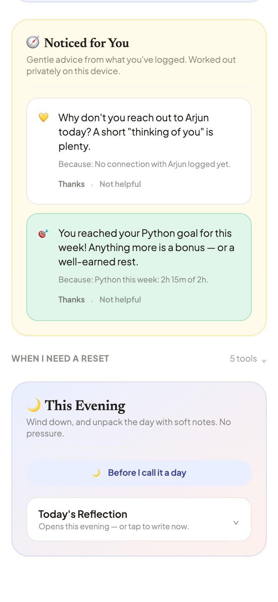
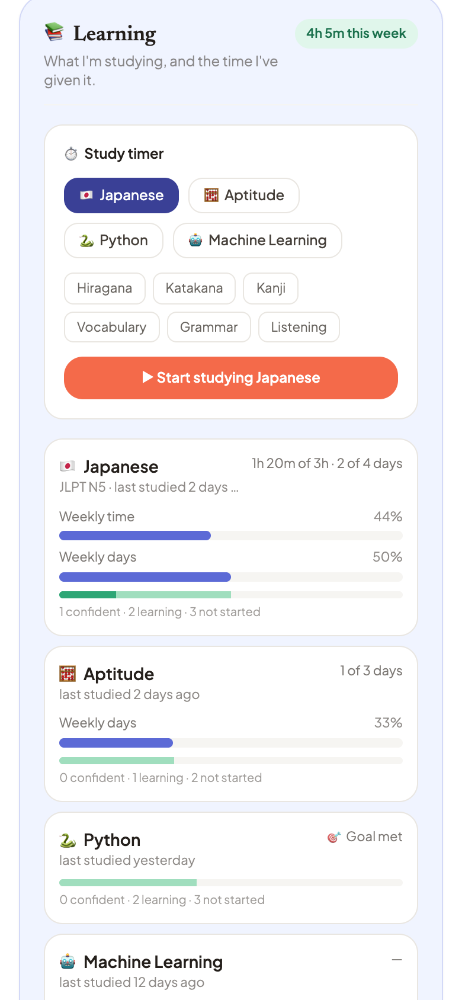
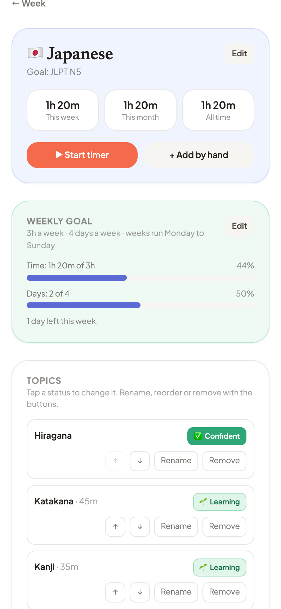
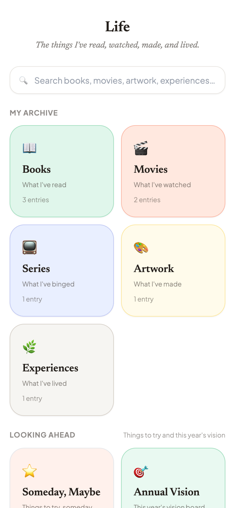
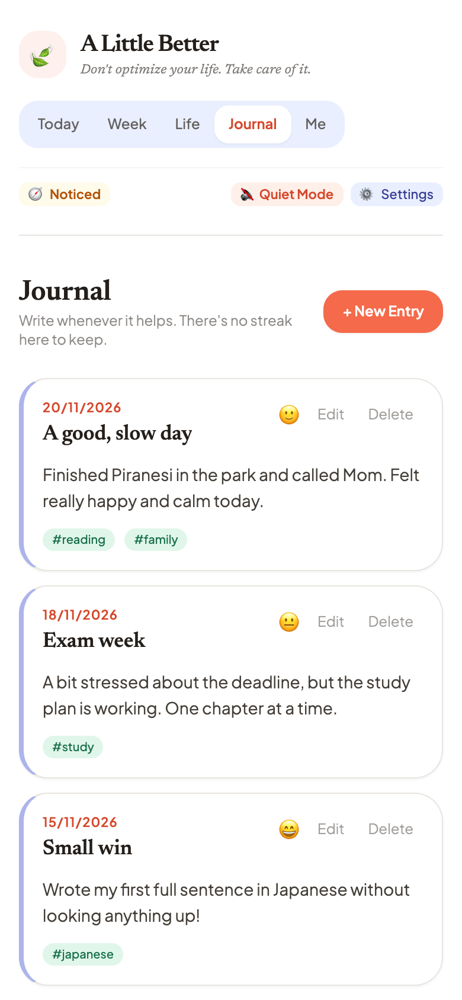
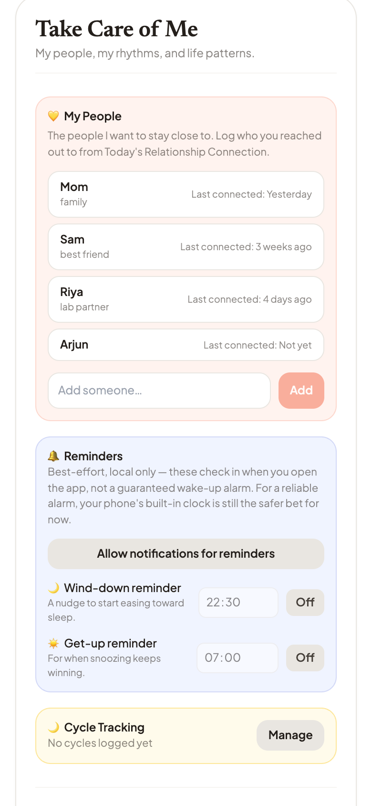
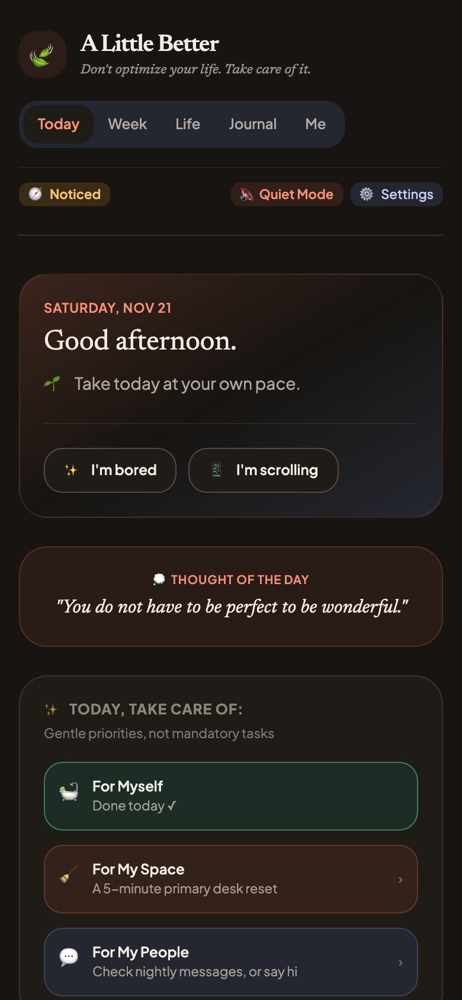

# A Little Better

> "Don't optimize your life. Take care of it."

A private, local-first life-care app — daily care, study, reflection, people, and the things I read, watch, make and live — with gentle, on-device advice drawn from my own logs. Installable on phone and desktop as a PWA, works fully offline, and optionally syncs across my own devices.

<p align="center">
  
  
  
</p>
<p align="center">
  
  
  
</p>
<p align="center">
  
  
</p>
<p align="center"><sub>Screenshots use made-up sample data.</sub></p>

## About the Project

A Little Better is a personal project built for my own daily life. The application is designed around my routines, preferences, reflections, and the way I want to interact with a personal care system.

The interface, visual language, prompts, and interactions are intentionally personalized to reflect my own needs and preferences. It is meant to feel calm and encouraging — a record of life, not a performance evaluation.

**Design principles**

- **Private by default** — everything lives on the device; nothing is sent anywhere unless I turn on sync with my own account.
- **Gentle, never pushy** — "Not today" is a valid answer, streaks never shame, and advice encourages rather than nags.
- **Grounded in real data** — every suggestion the app makes explains what it noticed, so it can be trusted.

## Features

### Today
- **Thought of the Day** — 366 original thoughts on hope, fun, opportunity and rest; a new one each day, never repeating within a year
- **Today, take care of** — three gentle priorities (myself, my space, my people) that tick off as things get done and jump to where to do them
- **Care for Me** — daily basics with an intentional "Not today" flow, reading minutes, and a low-friction focus timer
- **Care Around Me** — room reset timer, nightly message check, and relationship connection (tap who you reached out to)
- **Noticed for You** — private, on-device advice (see below)
- **When I need a reset** — guided tools for procrastination, overthinking, temper, self-doubt and insecurity, plus mindful redirects for boredom and doom-scrolling
- **This Evening** — a wind-down routine and the day's reflection

### Week
- A 7-day "showing up" strip and an at-a-glance summary of what filled the week
- **Learning** — a study log:
  - Subjects with editable topics (Not started → Learning → Confident), goals and goal dates
  - A **start/stop study timer** that keeps counting even if the app is closed, with a running-timer pill on every tab
  - Manual session logging, per-topic time, and weekly / monthly / all-time totals
  - **Weekly goals** per subject — study time and/or days per week (Monday–Sunday), with progress bars
- "Little things" from the week and gentle cycle reminders

### Life
A personal collection, grouped into **My archive** and **Looking ahead**:
- **Books** — reading records, re-reads, and Goodreads CSV import
- **Movies** — watch records, ratings, rewatches, and Letterboxd import
- **Series** — shows, seasons and episode tracking
- **Artwork** and **Experiences** — with photos
- **Someday, Maybe** and **Annual Vision** — things to try, and this year's intentions

### Journal
- Free writing with mood and tags, with no streak to keep
- Reflections from the reset tools can be saved to the Journal — only when explicitly chosen

### Me
- **My People** — the people I want to stay close to, with "last connected" tracking
- Best-effort local reminders (wind-down and get-up)
- Cycle tracking with import
- **Patterns & Insights** — reading, room resets, focus time, current streaks

### Settings
- Appearance: light, dark, or match device
- Sound chimes
- Cross-device sync: sign in, change password, forgot-password flow
- JSON backup export / import with validation before anything is replaced

## Noticed for You — the on-device advisor

A rule-based advisor that runs entirely on the device (no AI service, no network) and turns my own logs into a couple of gentle pieces of advice a day. Every piece of advice comes with a **"Because…"** line showing exactly what it noticed.

- **What it looks at:** study sessions and weekly goals, watching vs. focused time, binge-watching, doom-scrolling and boredom taps, reading and movement habits, gaps since an experience, artwork or contacting someone, Annual Vision progress, and themes in the journal and reflections (read with a small on-device word list that handles simple negation like "didn't cry").
- **Examples:**
  - *"I noticed last week's goals for Japanese and Aptitude didn't quite happen. That's okay — maybe aim for a little more this week. You wanted to 'Visit Japan' — a little Japanese brings that closer."*
  - *"You've caught yourself scrolling a few times. Try putting your phone in another room for one hour today."* — Because: 5 taps this week, 5 late at night.
- **Never repetitive:** picks are made once a day, the same advice rests for several days unless the data behind it changes, each kind has several wordings, and "Not helpful" quiets that kind of advice for a month.
- **Careful with heavy days:** if journal writing sounds very heavy, it offers support and suggests reaching out to someone trusted — never advice.
- Reachable from any tab via the **🧭 Noticed** button, with a dot when there's something new.

## Architecture

### Local-first

All data lives in **IndexedDB through Dexie**. Feature code never touches the database directly — it goes through a repository layer (`src/db/repositories`), which keeps persistence in one place and lets sync evolve independently. The PWA service worker keeps the app available offline, including after installation.

### Optional cross-device sync (Supabase)

When configured and signed in, data syncs between my own devices through Supabase (Postgres + Row Level Security + Storage). The app keeps working fully offline; sync catches up when it can.

- **Push, then pull, per table** — local-only data always reaches the account before anything could be pulled over it, so an empty account can never wipe a device.
- **Last-write-wins per row**, using each record's own `updatedAt`.
- **Two clocks, never mixed** — pushes compare against this device's clock; pulls use per-table cursors on the **server-assigned** `synced_at`, so a device with a wrong clock can't miss another device's changes. A small overlap window catches late-committing writes.
- **Deletes propagate** — soft deletes for most tables; tombstones for tables that hard-delete locally (care entries, images), plus Storage cleanup for photos.
- **Duplicate resolution** — if the same care item is ticked on two devices before syncing, the newer record wins everywhere.
- Study subjects and sessions reuse the existing `life_items` table (fields in a JSONB payload), so the feature needed no schema migration; each study session is its own row, so concurrent logging on two devices can't overwrite either.

See [`supabase/README.md`](supabase/README.md) for the schema, migrations and design notes.

### Project structure

```text
src/
├── app/                 App shell, navigation, theming
├── db/                  Dexie database, schema and repositories
├── features/
│   ├── today/           Daily care, Thought of the Day, evening
│   ├── week/            Week overview
│   ├── study/           Learning: subjects, timer, sessions, weekly goals
│   ├── advisor/         "Noticed for You" rules, selection and UI
│   ├── toolbox/         Reflection and reset tools
│   ├── journal/         Journal
│   ├── life/            Books, movies, series, artwork, experiences, wishlists
│   ├── people/          My People
│   ├── me/              Reminders, cycle tracking, patterns
│   └── settings/        Appearance, sync account, backups
├── lib/sync/            Supabase auth and the sync engine
└── shared/              Reusable components, hooks and utilities
tests/                   Vitest suites (sync, advisor, study, goals, thoughts)
supabase/                SQL migrations and sync documentation
```

## Technologies

- **Frontend:** React 18, TypeScript
- **Build tool:** Vite
- **Styling:** Tailwind CSS with a CSS-variable palette (light and dark)
- **Local database:** IndexedDB via Dexie
- **PWA:** vite-plugin-pwa, Workbox service worker
- **Cloud (optional):** Supabase — Auth, Postgres with Row Level Security, Storage
- **Testing:** Vitest with fake-indexeddb
- **Imports:** Goodreads and Letterboxd CSV

## Testing

```bash
npm test
```

The suites run the real sync engine against an in-memory database and a mock Supabase that assigns its own server timestamps — covering first sync, conflicts, delete propagation, duplicate resolution, clock skew, and error messages — plus the advisor's rules and non-repetition, the study log, weekly goals, and the daily-thought rotation.

## Data & Privacy

- No account or network connection is needed; all personal data stays on the device by default.
- Sync is opt-in and uses my own Supabase project, with Row Level Security so each account can only ever read its own rows.
- The advisor runs locally and never sends anything anywhere.
- Data can be exported to and restored from a JSON backup at any time.

## Running Locally

### Requirements

- Node.js 18+

### Install and run

```bash
npm install
npm run dev
```

The app will be available at the local URL printed by Vite, usually `http://localhost:5173`. To open it from another device on the same network:

```bash
npm run dev -- --host
```

### Optional: cross-device sync

Copy `.env.example` to `.env.local` and fill in your own Supabase project URL and public anon key, then apply the migrations in `supabase/migrations` (see [`supabase/README.md`](supabase/README.md)). Without these values the app runs fully local.

### Production build

```bash
npm run build
npm run preview -- --host
```

## Roadmap

- **On-device language understanding** — semantic search across the journal, automatic journal themes, and emotion understanding for the advisor, using a small sentence-embedding model that runs entirely in the browser
- **Personal pattern model** — a small model trained only on my own data, on-device, to surface what actually helps my mood and routines
- Hosting and installing on phone and desktop
